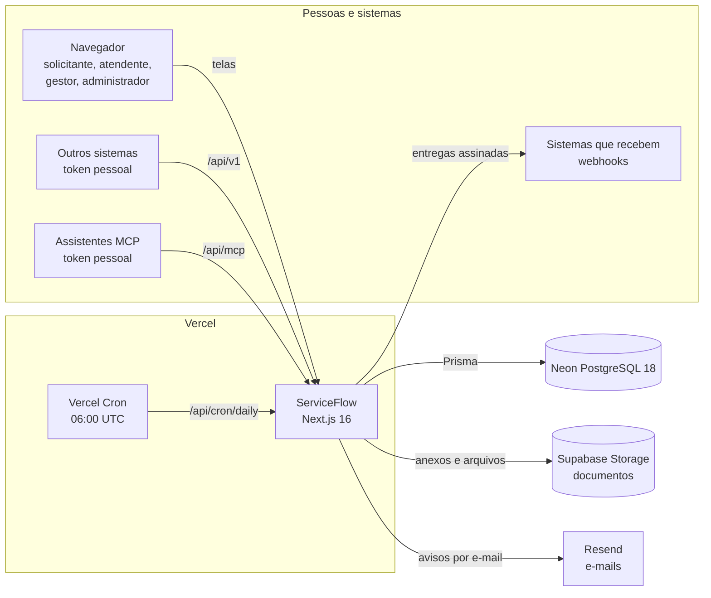
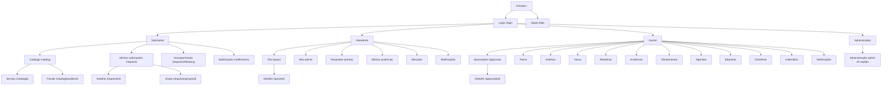
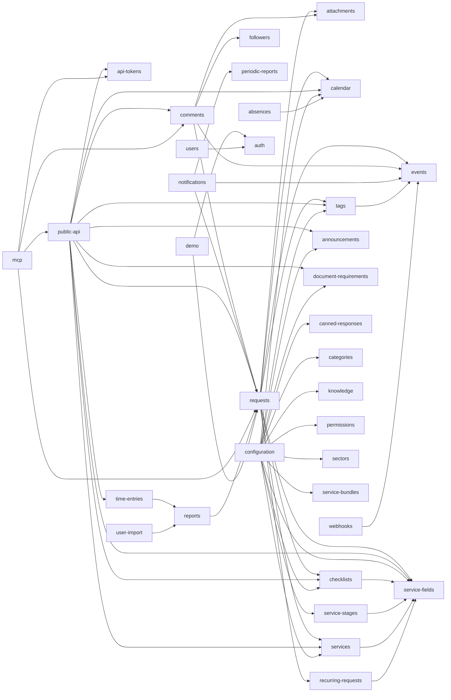

# Mapa do site e das dependências do ServiceFlow

Levantado em 2026-11-15 a partir do código (commit `0e3acf6`). Os diagramas são Mermaid, que o GitHub desenha na própria página.

## 1. Arquitetura: um sistema, módulos internos e serviços externos

O ServiceFlow **não é feito de microsserviços**. É uma única aplicação Next.js (um monólito modular), publicada na Vercel, dividida em **37 módulos internos** em `src/modules/` e uma camada comum em `src/server/`. Os módulos conversam por chamadas de função dentro do mesmo processo, sempre pela porta pública de cada um (`@/modules/<nome>`; o lint proíbe importar o interior de outro módulo). Fora da aplicação ficam só os serviços de infraestrutura abaixo.

| Serviço externo | Para quê | Variáveis de ambiente (só os nomes) |
|---|---|---|
| Neon PostgreSQL 18 | Todos os dados; migrations com Prisma | `DATABASE_URL` (com pooling) e a conexão direta para as migrations |
| Vercel | Hospeda a aplicação (região `gru1`) e o job diário | `AUTH_SECRET`, `CRON_SECRET` |
| Supabase Storage | Arquivos de anexos, comentários e documentos | `DOCUMENT_STORAGE_URL`, `DOCUMENT_STORAGE_BUCKET`, `DOCUMENT_STORAGE_SECRET_KEY` |
| Resend | Envio dos avisos por e-mail | `EMAIL_API_KEY`, `EMAIL_FROM`, `APP_BASE_URL` |
| Sistemas de terceiros | Recebem webhooks assinados | `WEBHOOK_ENCRYPTION_KEY` (cifra os segredos dos webhooks) |

## 2. Páginas por perfil

| Perfil | Páginas (menu e detalhes) |
|---|---|
| Todos, sem login | Entrada `/`, Login `/login`, Ajuda `/help` (temas gerais) |
| Todos, com login | Ajuda `/help` (temas gerais e o do perfil, link no menu), Meus dados `/account/data`, Acesso à API `/account/api-tokens`, Alterar senha `/account/password`, Avisos `/announcements` (com avisos), Serviços do setor `/sector-services` (com a permissão) |
| Solicitante | Catálogo `/catalog`, serviço `/catalog/{id}`, pacote `/catalog/bundles/{id}`, Minhas solicitações `/requests`, detalhe `/requests/{id}`, grupo `/requests/groups/{id}`, Acompanhando `/requests/following`, Notificações `/notifications` e preferências |
| Atendente | Fila do meu setor `/queue`, detalhe `/queue/{id}`, Meu painel `/queue/dashboard`, Respostas prontas `/queue/responses`, Minhas ausências `/queue/absences`, Menções `/queue/mentions`, Notificações `/queue/notifications` e preferências |
| Gestor | Aprovações `/approvals`, detalhe `/approvals/{id}`, Painel do setor, Análises, Horas, Relatórios (com relatório), Ausências, Afastamentos da equipe, Agendas, Etiquetas, Checklists, Calendário, Notificações e preferências |
| Administrador | `/admin` com as seções: Visão geral, Usuários, Importar usuários, Papéis, Setores, Etiquetas, Categorias, Serviços, Checklists, Pacotes, Base de conhecimento, Calendário, Ausências, Afastamentos de atendentes, Agendas, Configuração portátil, Avisos, E-mails, Painel, Análises, Horas, Relatórios, Auditoria, Acesso à API, Webhooks |

## 3. Rotas HTTP (`src/app/api`)

| Grupo | Rotas | Quem usa |
|---|---|---|
| Sessão | `/api/auth/[...nextauth]` | Login e saída |
| API pública v1 (token pessoal) | `/api/v1/me`, `/services`, `/requests` (listar e abrir), `/requests/{id}` e as ações `assume`, `start`, `complete`, `release`, `transfer`, `transfer-sector`, `cancel`, `reopen`, `pause-sla`, `resume-sla`, `comments`, `transfer-candidates`, `sector-candidates`; `/announcements`; `/sectors/{id}/calendar`; `/openapi.json` (público) | Outros sistemas |
| MCP | `/api/mcp` | Assistentes de IA, só leitura |
| Job diário | `/api/cron/daily` (protegida por `CRON_SECRET`) | Vercel Cron |
| Arquivos e relatórios | anexos e arquivos de comentários, `/api/reports/requests.csv`, `/api/reports/hours.csv`, `/api/configuration/export`, `/api/account/data`, `/api/user-imports/model.csv` e `/{id}/report.csv` | Telas, com a sessão |
| Notificações | `/api/notifications/{id}` (marca como lida e leva à solicitação ou ao relatório) | Telas |

## 4. Módulos internos e de quem cada um depende

Setas: "A → B" quer dizer que o módulo A usa a porta pública do módulo B. A auditoria é usada por quase todos os módulos de configuração.

| Módulo | O que faz | Usa |
|---|---|---|
| `requests` | Abertura, fila, ciclo de vida, prazos, aprovações, encaminhamento, lote | attachments, calendar, checklists, events, recurring-requests, service-fields, services, tags |
| `comments` | Comentários, notas internas, menções, arquivos | attachments, events, followers, requests |
| `attachments` | Documentos exigidos e arquivos no armazenamento | — |
| `events` | Fila de eventos (outbox) lida pelos consumidores | — |
| `notifications` | Avisos no sistema, e-mails e preferências | events, periodic-reports, requests |
| `webhooks` | Cadastro e entrega assinada dos webhooks | audit, events |
| `public-api` | API `/api/v1` sobre os casos de uso das telas | announcements, api-tokens, calendar, checklists, comments, document-requirements, requests, service-fields, services, tags, time-entries |
| `mcp` | Servidor MCP só de leitura | api-tokens, comments, public-api, requests |
| `api-tokens` | Tokens pessoais e limite de chamadas | audit |
| `audit` | Trilha de auditoria e "Meus dados" | api-tokens |
| `auth`, `users` | Login, contas, anonimização | auth, audit |
| `permissions` | Permissões e papéis de acesso | audit |
| `sectors`, `categories`, `services`, `service-fields`, `service-stages`, `document-requirements`, `service-bundles` | Configuração do catálogo, campos, etapas, documentos e pacotes | audit, service-fields |
| `checklists`, `tags`, `canned-responses`, `knowledge`, `followers`, `saved-views`, `time-entries` | Recursos do atendimento no dia a dia | audit, events, service-fields, reports |
| `calendar` | Calendário da organização e dos setores | audit |
| `absences` | Ausências e substituições | calendar |
| `recurring-requests` | Agendas de solicitações recorrentes | audit, service-fields |
| `announcements` | Avisos e manutenção programada | audit |
| `user-import` | Importação de usuários por CSV | audit, reports |
| `periodic-reports` | Relatórios semanais e mensais | audit |
| `reports` | Painel, análises, exportações | requests |
| `configuration` | Configuração portátil (versão 3) | 14 módulos de configuração e audit |
| `demo` | Dados de demonstração | auth, requests |
| `help` | Temas e perguntas da página "Ajuda", com a busca (conteúdo no código) | — |

**Camada comum (`src/server/`):** `auth` (sessão), `authorization` (perfil, setor e permissões), `db` (Prisma e transações serializáveis), `errors`, `validation`, `storage` (Supabase Storage), `jobs` (job diário) e `config`. **`src/shared/`** guarda regras puras usadas por vários módulos (relógio do prazo, horários, períodos, rótulos).

## 5. Job diário (`/api/cron/daily`)

Na ordem: alertas de prazo → regras de escalonamento → passagem das solicitações de atendentes ausentes → agendas recorrentes → prazos de aprovação → prazos de etapa → relatórios periódicos (com os avisos aos gestores) → eventos (notificações e webhooks) → e-mails → entregas de webhooks → limpezas por prazo de retenção (eventos, notificações, e-mails, auditoria, webhooks, janelas da API e tokens encerrados).

## 6. Pacotes npm

| Uso | Pacotes |
|---|---|
| Produção | `next` 16.3.8, `react` e `react-dom` 19.2.8, `next-auth` 5 (beta), `argon2` (senhas), `zod` 4 (validação), `@next/env`, `tsx` |
| Desenvolvimento e testes | `prisma` e `@prisma/client` 6.16, `typescript` 5, `vitest` 4, `vite` 6, `@playwright/test`, `eslint` 9 com `eslint-config-next` (traz o `axe-core` usado nas verificações de contraste) |
